# PoC réseau – Plateforme de téléradiologie sécurisée

*[English version below](#english-version)*

Maquette GNS3 d'une infrastructure réseau multi-sites sécurisée pour une entreprise de téléradiologie : segmentation VLAN, routage OSPF, pare-feu stateful VyOS, DMZ applicative et zones Extranet.

> **Projet de groupe de 4 (EPISEN, filière ITS), 2025-2026 – ma partie : conception et configuration du pare-feu VyOS et intégration des VM dans GNS3.**

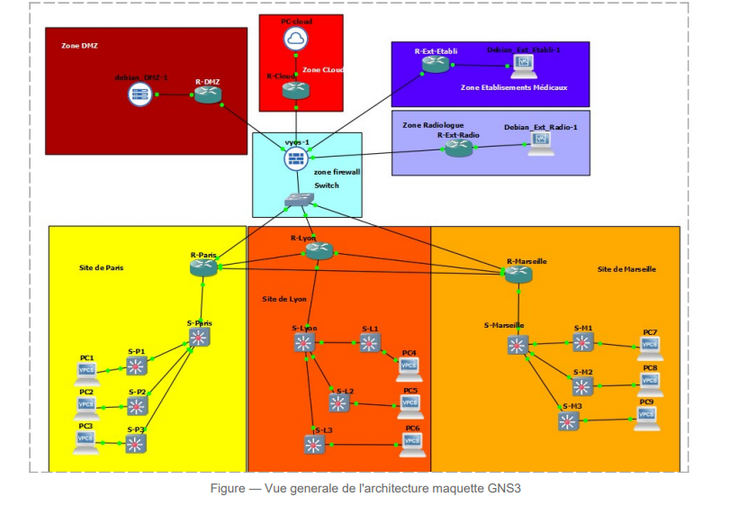

## Sommaire

- [Contexte](#contexte)
- [Zones de confiance](#zones-de-confiance)
- [Équipements](#équipements)
- [Adressage](#adressage)
- [VLAN et router-on-a-stick](#vlan-et-router-on-a-stick)
- [Routage OSPF](#routage-ospf)
- [Pare-feu VyOS](#pare-feu-vyos)
- [Services](#services)
- [Tests](#tests)
- [Démarche en 5 jalons](#démarche-en-5-jalons)
- [Prévu en production, non réalisé](#prévu-en-production-non-réalisé)
- [Limites connues](#limites-connues)
- [Contenu du dépôt](#contenu-du-dépôt)

## Contexte

Une entreprise de téléradiologie (3 sites : Paris, Lyon, Marseille, environ 300 salariés dont une cinquantaine en mobilité) reçoit des images médicales d'établissements de santé, les met à disposition de radiologues distants et renvoie les comptes rendus. Ces données de santé imposent :

- **RGPD** : confidentialité, traçabilité, privacy by design (art. 25, 30, 32, 35) ;
- **HDS** : hébergement certifié des données de santé, séparation des environnements, contrôle d'accès ;
- **DICOM** (TCP 104, ou 11112 en TLS) pour les images, **HL7** (TCP 2575) pour les données cliniques.

L'objectif du PoC est de valider sous GNS3 une architecture en défense en profondeur : aucune zone peu fiable n'accède directement à une zone critique.

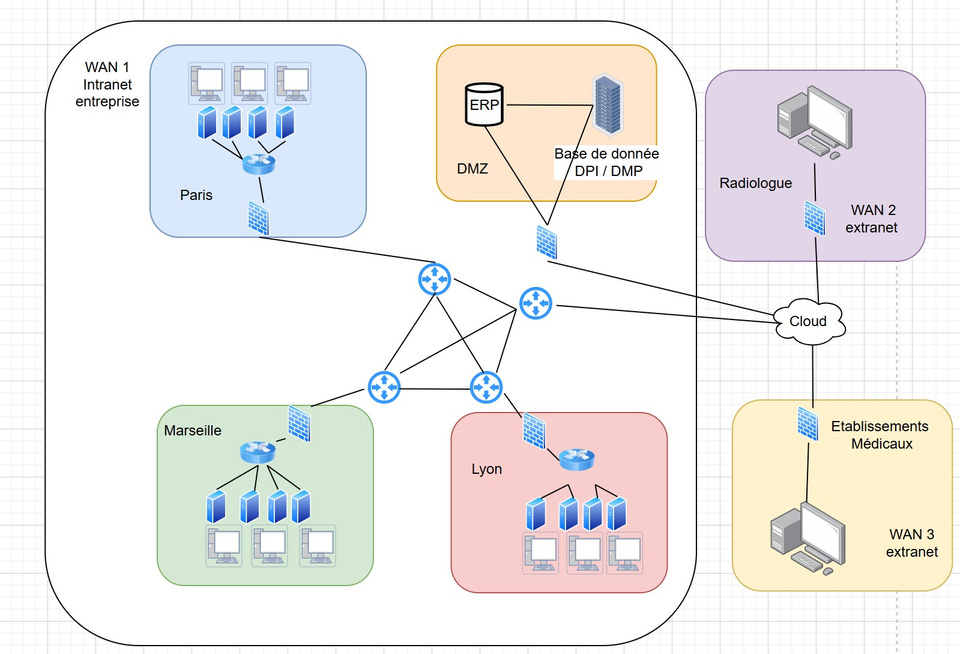

## Zones de confiance

| Zone | Composants | Confiance |
|---|---|---|
| Intranet Paris / Lyon / Marseille | Routeur de site, switch cœur, 3 switchs d'étage, 3 PC (VPCS) | Élevée |
| Zone pare-feu | VyOS + switch WAN | Moyenne |
| DMZ | R-DMZ + VM Debian 12 / Apache2 | Contrôlée |
| Cloud HDS | R-Cloud + PC-Cloud | Contrôlée |
| Extranet Radiologues | R-Ext-Radio + VM Debian 12 (XFCE, Firefox) | Faible |
| Extranet Établissements | R-Ext-Etabli + VM Debian 12 (XFCE, Firefox) | Faible |

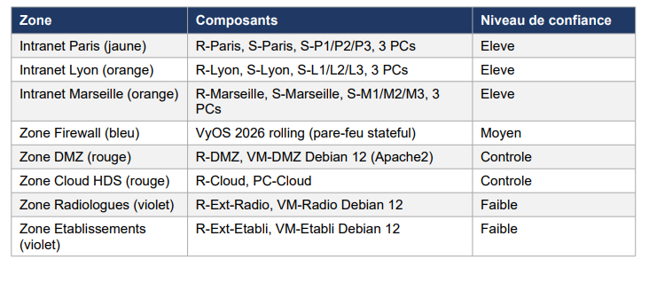

Chaque site suit le même modèle : un switch cœur relié à trois switchs d'étage.

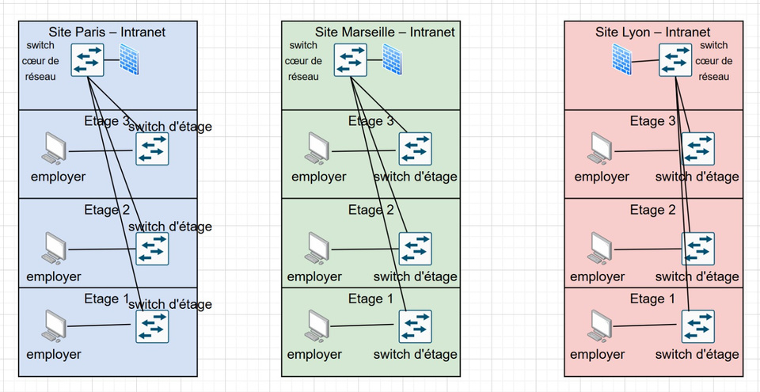

## Équipements

| Rôle | Équipement |
|---|---|
| Routeurs (sites, DMZ, Cloud, Extranet) | Cisco c3725, IOS 12.4 (Dynamips) |
| Switchs cœur et d'étage | Cisco c3660 + NM-16ESW, IOS 12.4 |
| Pare-feu central | VyOS rolling 2026 (VM VirtualBox) |
| Serveur DMZ | Debian 12 + Apache2 |
| Postes Extranet | Debian 12 + XFCE + Firefox |
| Postes LAN | VPCS (3 par site au lieu de 50, ce qui suffit pour valider VLAN et routage) |

**Pourquoi VyOS ?** pfSense a été écarté : sous GNS3/QEMU, il exige l'accélération HAXM, qui ne fonctionne pas quand Hyper-V est actif. VyOS fournit nativement un firewall stateful, IPsec et OSPF, et tourne sous VirtualBox. L'intégration a demandé de passer les adaptateurs VirtualBox en « Aucune connexion » et d'identifier à la main le vrai mapping des interfaces, car VyOS voyait des interfaces fantômes. Tant que ce mapping était faux, OSPF ne montait pas.

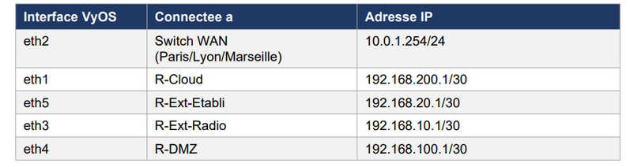

## Adressage

Uniquement des plages privées RFC 1918.

| Réseau | Plage |
|---|---|
| Sites | Paris 172.16.0.0/16, Lyon 172.17.0.0/16, Marseille 172.18.0.0/16, avec un /24 par VLAN (172.1x.**VLAN**.0/24, passerelle .1) |
| Liens WAN inter-sites | 10.0.0.0/30 (Paris–Lyon), 10.0.0.4/30 (Lyon–Marseille), 10.0.0.8/30 (Paris–Marseille) |
| Switch WAN ↔ VyOS | 10.0.1.0/24 (R-Paris .1, R-Lyon .2, R-Marseille .3, VyOS .254) |
| VyOS ↔ routeurs de zone | 192.168.10.0/30 (Radio), 192.168.20.0/30 (Etabli), 192.168.100.0/30 (DMZ), 192.168.200.0/30 (Cloud) |
| Zones | DMZ 192.168.101.0/24 (serveur .10), Cloud 192.168.201.0/24, Radio 192.168.11.0/24, Etabli 192.168.21.0/24 |

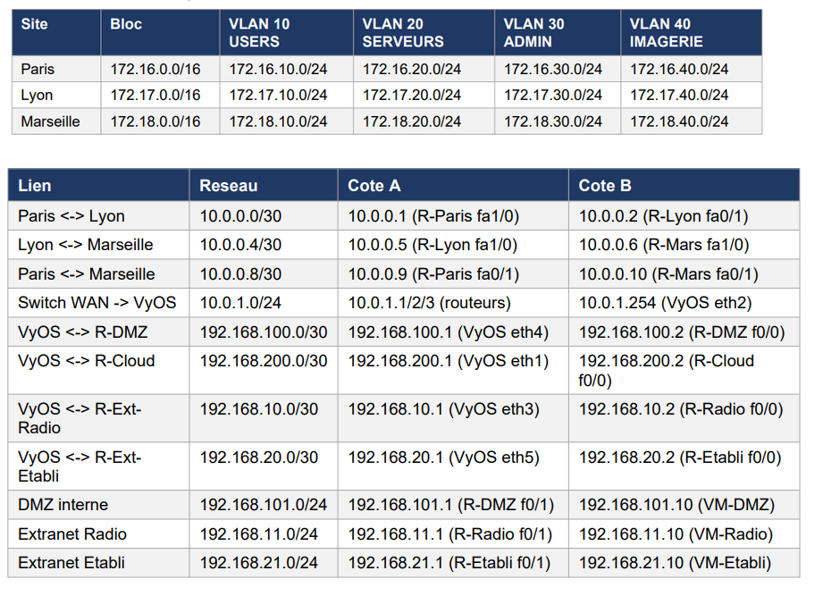

## VLAN et router-on-a-stick

| VLAN | Nom | Usage |
|---|---|---|
| 10 | USERS | Postes bureautiques (zone exposée) |
| 20 | SERVEURS | Ressources internes |
| 30 | ADMIN | Équipements réseau |
| 40 | IMAGERIE | IRM, scanners (isolation des appareils médicaux) |

Les switchs sont reliés par des trunks 802.1Q. Le routage inter-VLAN se fait en **router-on-a-stick** : sous-interfaces `fa0/0.10/.20/.30/.40` en `encapsulation dot1Q` sur chaque routeur de site.

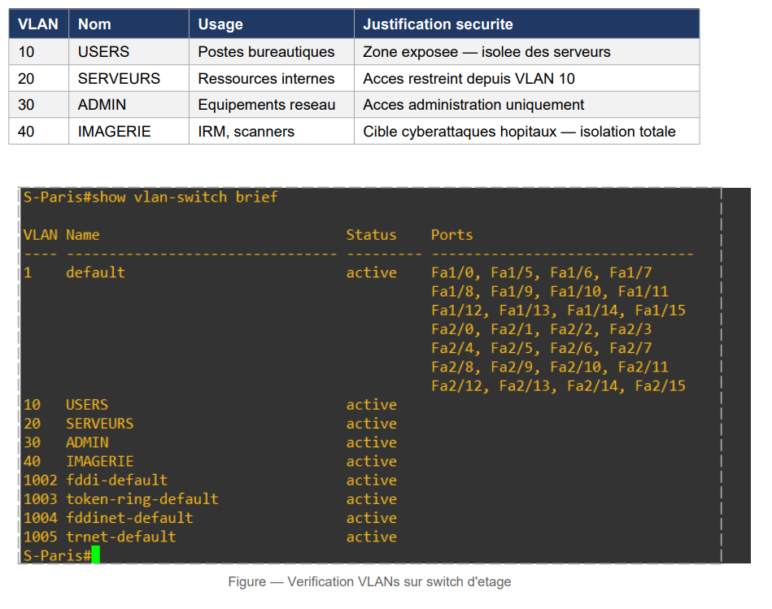
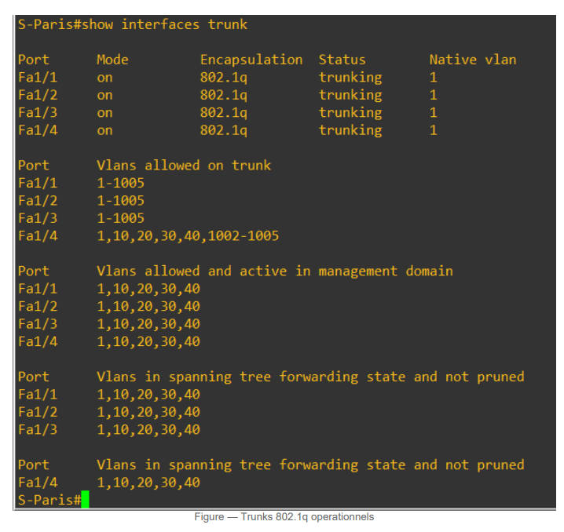

## Routage OSPF

OSPF area 0 entre R-Paris (1.1.1.1), R-Lyon (2.2.2.2), R-Marseille (3.3.3.3) et VyOS (4.4.4.4), sur le maillage /30 et le switch WAN. VyOS ajoute des routes statiques vers les /16 des sites et vers les réseaux de zone. Les routeurs de zone (DMZ, Cloud, Extranet) utilisent des routes statiques vers VyOS.

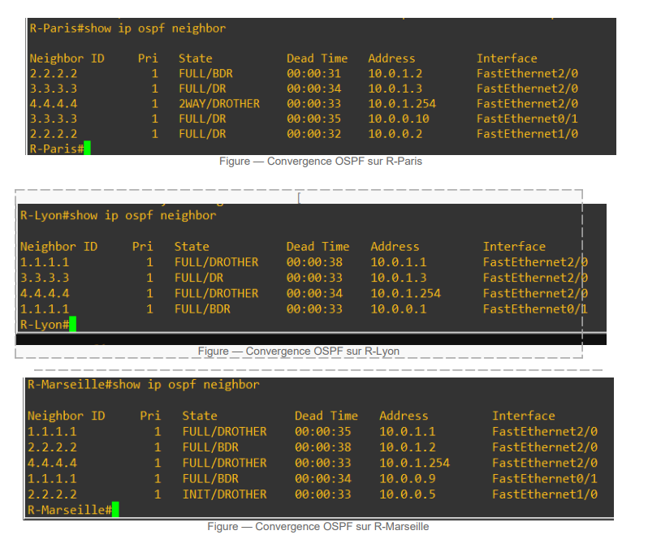
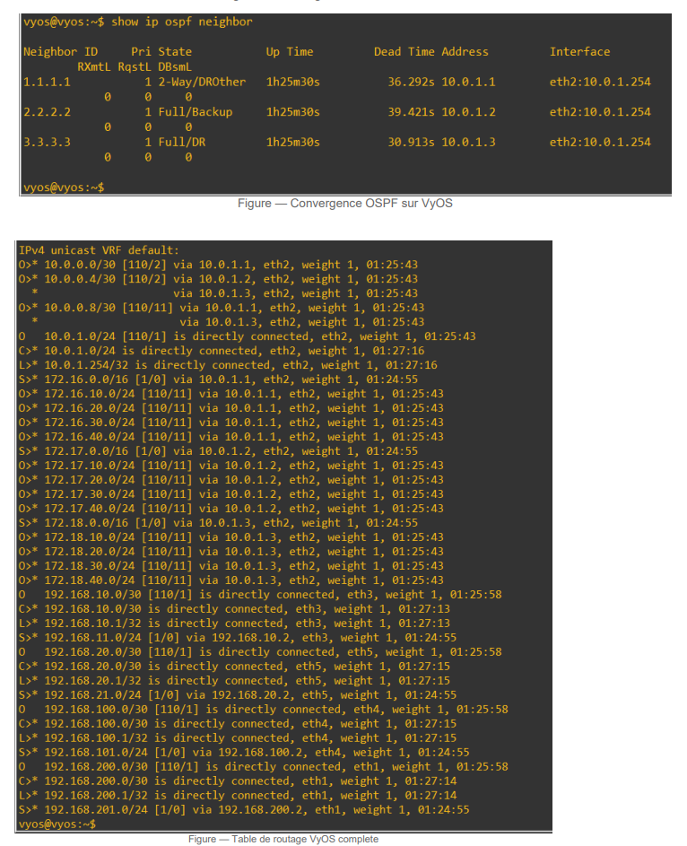

## Pare-feu VyOS

Pare-feu stateful : la `state-policy` accepte le trafic retour (established/related). Chaque interface d'entrée est envoyée vers un ruleset nommé par une règle `jump` du forward filter. **Chaque ruleset se termine par un drop (deny par défaut).**

| Ruleset | Interface | Autorisé | Par défaut |
|---|---|---|---|
| **DMZ-IN** | eth4 (DMZ) | TCP 443, TCP 104 (DICOM), ICMP, sources VyOS / WAN / sites internes | drop |
| **RADIO-IN** | eth3 (Radiologues) | Radio → DMZ, Radio → Cloud HDS, ICMP | drop (pas d'accès aux 172.x) |
| **ETABLI-IN** | eth5 (Établissements) | Etabli → DMZ uniquement, ICMP | drop |

La configuration complète est dans [`configs/vyos.conf`](configs/vyos.conf).

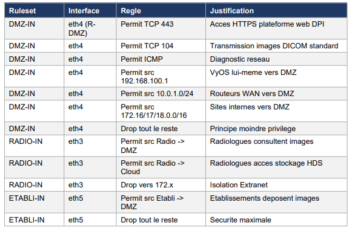
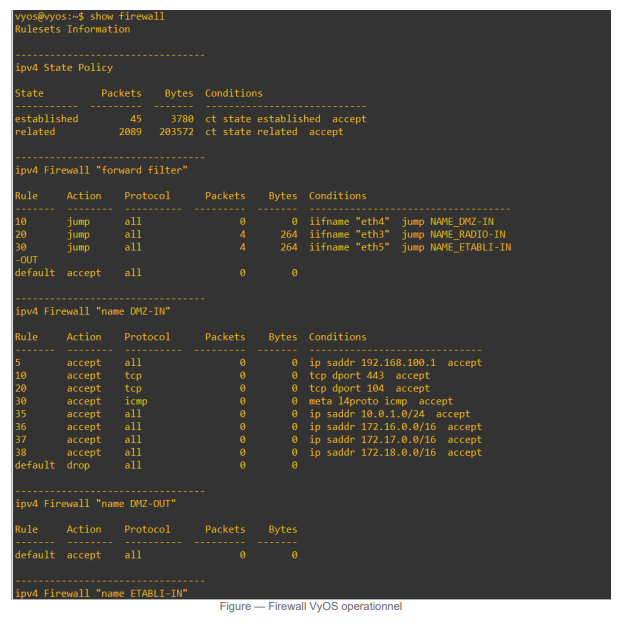

## Services

- **Apache2 en DMZ** (Debian 12, 192.168.101.10) : site statique « TeleRad Pro » (connexion par rôle radiologue / établissement, tableau de bord, formulaire de dépôt de fichiers DICOM).
- Accès en Firefox depuis les VM Extranet.

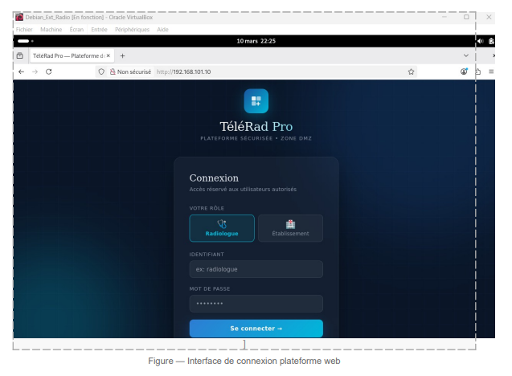

## Tests

| # | Test | Source → destination | Résultat |
|---|---|---|---|
| T01 | Inter-sites | PC Paris 172.16.10.10 → PC Lyon 172.17.10.10 | OK, TTL 62 |
| T02 | Inter-sites | PC Paris → PC Marseille 172.18.10.10 | OK, TTL 62 |
| T03 | Interne → DMZ | PC Paris → VM-DMZ 192.168.101.10 | Noté OK, voir [limites](#limites-connues) |
| T04 | Extranet Radio → DMZ | VM-Radio 192.168.11.10 → VM-DMZ | OK, TTL 61 |
| T05 | Radio → interne | VM-Radio → PC Paris | Bloqué, ICMP 3/13 *administratively prohibited* |
| T06 | Extranet Etabli → DMZ | VM-Etabli 192.168.21.10 → VM-DMZ | OK |
| T07 | Web radiologue | Firefox VM-Radio → http://192.168.101.10 | Page TeleRad Pro |
| T08 | Web établissement | Firefox VM-Etabli → http://192.168.101.10 | Page TeleRad Pro |
| T09 | Dépôt DICOM | VM-Etabli, rôle établissement | Simulation dans l'interface |
| T10 | Radio → 172.x | VM-Radio → réseaux internes | Bloqué, ICMP admin. prohibited |

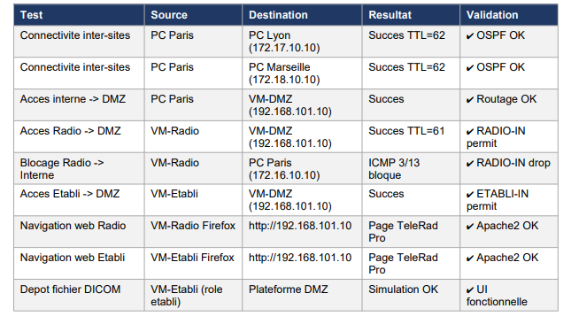
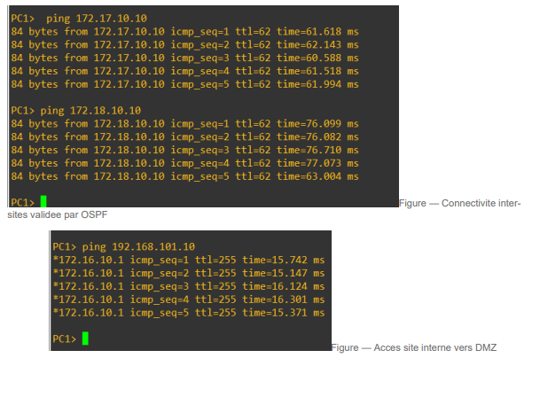
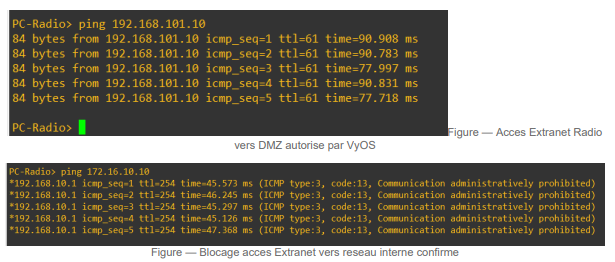
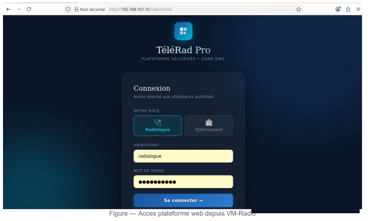

## Démarche en 5 jalons

| Jalon | Contenu |
|---|---|
| 1 – Cadrage | Analyse du besoin, première esquisse d'architecture, étude de marché, business plan avec prix planchers |
| 2 – Cahier des charges | Cadre réglementaire (RGPD, HDS, ISO 27001, DICOM, HL7), exigences fonctionnelles et non fonctionnelles, critères de validation |
| 3 – Conception | Zones de confiance, scénario d'échange, choix justifiés (VLAN, deny by default, OSPF, DMZ, VPN, Cloud HDS) |
| 4 – Prototype | Maquette GNS3 complète : adressage, VLAN, OSPF, intégration de VyOS, DMZ Apache, VM Extranet, tests |
| 5 – Finalisation | Dossier de recette, manuels d'utilisation et de déploiement, maintenance, bilan économique, analyse de vulnérabilités |

## Prévu en production, non réalisé

- VPN **IPsec** site-à-site (AES-256) entre les 3 sites ;
- **VPN client** (IKEv2) pour les ~50 radiologues mobiles, avec **2FA** ;
- **HTTPS** (TLS) sur la plateforme web ;
- **DICOM TLS** (port 11112) ;
- **VRRP** pour la redondance des passerelles ;
- **IDS/IPS** sur les flux DICOM (et supervision Zabbix) ;
- durcissement des équipements : `enable secret`, SSH, mots de passe de lignes, BPDU guard, VLAN natif autre que 1. Les configs Cisco du PoC n'ont aucun mot de passe.

## Limites connues

- **T03** : les réponses au ping vers 192.168.101.10 viennent de `*172.16.10.1` avec un TTL de 255. Dans VPCS, l'astérisque signifie que la réponse vient de la passerelle et non de la cible : la VM-DMZ n'a donc probablement **pas** été atteinte, même si le test a été noté réussi.
- **OSPF Lyon–Marseille** : sur R-Marseille, le voisin 2.2.2.2 via le lien direct 10.0.0.5 reste en état `INIT`. L'adjacence sur ce lien n'est pas établie (le trafic passe par le switch WAN).
- **Règle 40 / DMZ-OUT** : la configuration d'origine contenait une règle 40 du forward filter (`inbound-interface eth4` → `DMZ-OUT`) en doublon de la règle 10, donc jamais atteinte, et le ruleset DMZ-OUT n'était pas défini. Elle est supprimée et commentée dans `vyos.conf`.
- **RADIO-IN et ICMP** : la règle 30 de RADIO-IN accepte tout l'ICMP. Le blocage ICMP 3/13 observé aux tests T05/T10 ne s'explique donc pas avec la seule configuration retranscrite : la config réelle de la VM différait probablement de l'annexe.
- **PoC en HTTP** : aucun chiffrement des échanges dans la maquette.
- **Dépôt DICOM simulé** : le site est statique (HTML/CSS), sans backend ni stockage réel des fichiers.
- La configuration VyOS est une retranscription du rapport et non un export de la VM.

## Contenu du dépôt

```
configs/   19 configurations Cisco IOS (startup-config) + vyos.conf
gns3/      fichier projet GNS3 (topologie seule)
images/    schémas et captures issus des rapports
```

Correspondance avec les noms des nœuds GNS3 : `SW-Core-<site>` = S-Paris / S-Lyon / S-Marseille, `SW-Floor<n>-<site>` = S-P*n* / S-L*n* / S-M*n*.

Le fichier `.gns3` ne contient que la topologie. Les images IOS (sous licence) et les VM VirtualBox (VyOS, Debian DMZ, Debian Radio, Debian Etabli) ne sont pas fournies.

---

## English version

# Network PoC – Secure teleradiology platform

GNS3 lab of a secure multi-site network for a teleradiology company: VLAN segmentation, OSPF routing, VyOS stateful firewall, application DMZ and Extranet zones.

> **Group project of 4 (EPISEN engineering school, ITS track), 2025-2026 – my part: design and configuration of the VyOS firewall and integration of the VMs into GNS3.**

### Context

A teleradiology company (3 sites: Paris, Lyon, Marseille, about 300 employees including ~50 mobile workers) receives medical images from healthcare facilities, makes them available to remote radiologists and sends back the reports. This health data falls under **GDPR** (privacy by design, traceability, security), French **HDS** certification (certified health-data hosting), **DICOM** (TCP 104, or 11112 over TLS) and **HL7** (TCP 2575). The PoC validates a defence-in-depth architecture in GNS3: no low-trust zone reaches a critical zone directly.

### Trust zones

| Zone | Components | Trust |
|---|---|---|
| Paris / Lyon / Marseille intranets | Site router, core switch, 3 floor switches, 3 VPCS hosts | High |
| Firewall zone | VyOS + WAN switch | Medium |
| DMZ | R-DMZ + Debian 12 / Apache2 VM | Controlled |
| HDS Cloud | R-Cloud + PC-Cloud | Controlled |
| Radiologists Extranet | R-Ext-Radio + Debian 12 VM (XFCE, Firefox) | Low |
| Facilities Extranet | R-Ext-Etabli + Debian 12 VM (XFCE, Firefox) | Low |

### Equipment

Cisco c3725 routers and c3660 + NM-16ESW switches (IOS 12.4, Dynamips), VyOS rolling 2026 as the central firewall (VirtualBox VM), Debian 12 VMs, VPCS hosts (3 per site instead of 50). pfSense was dropped because it needs HAXM, which does not work while Hyper-V is enabled. Integrating VyOS required setting the VirtualBox adapters to "Not attached" and working out the real interface mapping by hand, because of ghost interfaces. OSPF would not come up until that mapping was right.

### Addressing

Private RFC 1918 ranges only. Sites: 172.16/17/18.0.0/16, one /24 per VLAN (gateway .1). Inter-site WAN links: 10.0.0.0/30, .4/30, .8/30. WAN switch to VyOS: 10.0.1.0/24 (VyOS .254). VyOS to zone routers: 192.168.10/20/100/200.0/30. Zones: DMZ 192.168.101.0/24 (server .10), Cloud 192.168.201.0/24, Radio 192.168.11.0/24, Facilities 192.168.21.0/24.

### VLANs and router-on-a-stick

VLAN 10 USERS, 20 SERVERS, 30 ADMIN, 40 IMAGING (isolated medical devices). 802.1Q trunks between switches. Inter-VLAN routing uses sub-interfaces `fa0/0.10/.20/.30/.40` (`encapsulation dot1Q`) on each site router.

### OSPF

OSPF area 0 between R-Paris (1.1.1.1), R-Lyon (2.2.2.2), R-Marseille (3.3.3.3) and VyOS (4.4.4.4). VyOS adds static routes to the sites' /16s and to the zone networks. The zone routers use static routes towards VyOS.

### VyOS firewall

Stateful firewall: the `state-policy` accepts return traffic. Each ingress interface jumps to a named ruleset from the forward filter, and **every ruleset ends with a default drop (deny by default)**.

| Ruleset | Interface | Allowed | Default |
|---|---|---|---|
| **DMZ-IN** | eth4 (DMZ) | TCP 443, TCP 104 (DICOM), ICMP, sources from VyOS / WAN / internal sites | drop |
| **RADIO-IN** | eth3 (Radiologists) | Radio → DMZ, Radio → HDS Cloud, ICMP | drop (no access to 172.x) |
| **ETABLI-IN** | eth5 (Facilities) | Facilities → DMZ only, ICMP | drop |

Full configuration: [`configs/vyos.conf`](configs/vyos.conf).

### Services

Apache2 in the DMZ (Debian 12, 192.168.101.10) hosts a static "TeleRad Pro" website (role-based login, dashboard, DICOM upload form), reached with Firefox from the Extranet VMs.

### Tests

| # | Test | Result |
|---|---|---|
| T01-T02 | Paris PC → Lyon / Marseille PCs | OK, TTL 62 |
| T03 | Paris PC → DMZ VM | Reported OK, see known limitations |
| T04 | Radio VM → DMZ | OK, TTL 61 |
| T05 / T10 | Radio VM → internal 172.x networks | Blocked, ICMP 3/13 administratively prohibited |
| T06 | Facilities VM → DMZ | OK |
| T07-T08 | Firefox → http://192.168.101.10 from both Extranet VMs | TeleRad Pro page displayed |
| T09 | DICOM upload (facility role) | Simulated in the UI |

### 5-milestone approach

1. Scoping, first architecture sketch, market study and business plan. 2. Requirements specification (GDPR, HDS, ISO 27001, DICOM, HL7). 3. Detailed design (trust zones, justified technical choices). 4. Working GNS3 prototype and tests. 5. Acceptance file, user and deployment guides, maintenance, cost review, vulnerability analysis.

### Planned for production, not implemented

Site-to-site **IPsec** (AES-256), **client VPN** (IKEv2) with **2FA**, **HTTPS**, **DICOM TLS**, **VRRP**, **IDS/IPS** (plus Zabbix monitoring), and device hardening (enable secret, SSH, line passwords, BPDU guard, non-default native VLAN). The PoC's Cisco configs have no passwords.

### Known limitations

- **T03**: the replies come from `*172.16.10.1` with TTL 255, i.e. from the gateway, not from the target. The DMZ VM was probably **not** reached even though the test was marked as passed.
- **Lyon–Marseille OSPF**: on R-Marseille, neighbour 2.2.2.2 over the direct link stays in `INIT`.
- **Rule 40 / DMZ-OUT**: the original forward filter had a rule 40 (eth4 → `DMZ-OUT`) duplicating rule 10, so it was never reached, and DMZ-OUT was not defined. It is removed and documented in `vyos.conf`.
- **RADIO-IN and ICMP**: rule 30 accepts all ICMP, so the ICMP 3/13 block seen in T05/T10 cannot come from the transcribed config alone. The real VM config probably differed from the report.
- **HTTP only** in the PoC, no encryption.
- **Simulated DICOM upload**: static site, no backend or real storage.
- The VyOS configuration is transcribed from the report, not exported from the VM.

### Repository layout

`configs/` (19 Cisco IOS startup-configs + `vyos.conf`), `gns3/` (topology-only GNS3 project), `images/` (diagrams and screenshots). Licensed IOS images and the VirtualBox VMs are not included.
